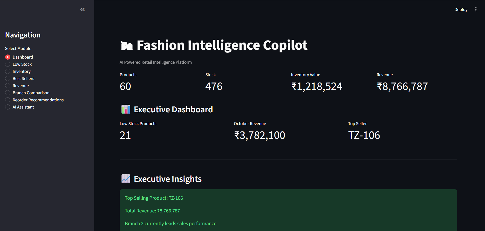

# 🛍 Fashion Intelligence Copilot

## 🌐 Live Demo

### Streamlit Application

👉 https://fashion-intelligence-copilot-bwvwrbjuqy9bmrvrupqg3t.streamlit.app/

### GitHub Repository

👉 https://github.com/Jagadeesh7532/fashion-intelligence-copilot

---

# Overview

Fashion Intelligence Copilot is an AI-powered retail analytics and decision-support platform designed for fashion retailers.

The platform transforms raw inventory and sales data into actionable business insights through analytics dashboards, recommendation engines, and a conversational AI assistant.

The goal is to help retail managers make informed decisions related to inventory management, revenue optimization, branch performance, sales analysis, and festive demand planning.

---

# Objectives

This platform helps fashion retailers to:

- Monitor inventory levels
- Identify low-stock products
- Analyze sales performance
- Compare branch performance
- Generate reorder recommendations
- Detect slow-moving inventory
- Answer business questions using natural language
- Support better retail decision-making

---

# Key Features

## 📦 Inventory Analytics

- Total Product Tracking
- Stock Quantity Monitoring
- Inventory Value Calculation
- Low Stock Detection
- Branch-wise Inventory Visibility

## 💰 Revenue Analytics

- Total Revenue Analysis
- October Revenue Analysis
- Order Volume Tracking
- Revenue Performance Insights

## 🏆 Sales Intelligence

- Best Selling Products
- Product Demand Analysis
- Branch Performance Comparison
- Category Revenue Analysis

## 🚚 Recommendation Engine

- Diwali Reorder Recommendations
- Inventory Prioritization
- Discount Recommendations
- Inventory Risk Identification
- Festive Readiness Planning

## 🤖 AI Business Assistant

Natural Language Queries:

```text
best sellers

revenue

inventory summary

low stock products

branch comparison

reorder recommendations
```

The AI assistant transforms business analytics into actionable recommendations for store owners.

---

# Challenge Deliverables

## ✅ Part A Features

- Retrieve inventory by branch or overall
- Identify low-stock products
- Find best-selling products
- Search products by category and price
- Generate inventory summaries

## ✅ Part B Business Questions

- Reorder recommendations before Diwali
- Discount recommendations for slow-moving inventory
- Saree sales comparison between branches
- October revenue and top-performing category analysis
- Non-existent product validation (TZ-999)

---

# Business Questions Addressed

## 1️⃣ Which Products Should Be Reordered Before Diwali?

The recommendation engine combines:

- Current Stock
- Reorder Threshold
- October Demand Trends

Top Recommendations:

| Product | Branch | Recommended Quantity |
|----------|----------|----------:|
| TZ-106 Haldi Special Kota Saree | Branch 1 | 142 |
| TZ-106 Haldi Special Kota Saree | Branch 2 | 143 |
| TZ-112 Classic Cotton Kurta | Branch 1 | 105 |
| TZ-112 Classic Cotton Kurta | Branch 2 | 112 |

Business Insight:

Products with strong October demand and low inventory are prioritized for replenishment before festive sales.

---

## 2️⃣ Which Products Should Be Discounted?

Products identified with high stock and low sales:

- Navy Nehru Jacket Set
- Sky Blue Sequin Saree
- Maroon Velvet Kurta Set
- Bandhani Cotton Saree

Business Insight:

These items represent slow-moving inventory and may benefit from discounting to improve stock turnover.

---

## 3️⃣ Compare Saree Sales Between Branches

| Branch | Saree Units Sold |
|----------|----------:|
| Branch 1 | 215 |
| Branch 2 | 347 |

Business Insight:

Branch 2 outperformed Branch 1 in saree sales during October.

---

## 4️⃣ October Revenue Performance

| Metric | Value |
|----------|---------:|
| Total Revenue | ₹87,66,787 |
| October Revenue | ₹37,82,100 |
| Total Orders | 3021 |

### Top Revenue Category

**Saree**

Revenue Contribution:

**₹17,77,831**

Business Insight:

Sarees contributed the highest revenue share during October and represent the strongest-performing category.

---

## 5️⃣ Product Validation

Query:

```text
How many pieces of TZ-999 do we have?
```

Response:

```text
Product TZ-999 does not exist in inventory.
```

Business Insight:

The system avoids hallucinations and only responds with verified inventory information.

---

# System Architecture

```text
User
 │
 ▼

Streamlit Dashboard
 │
 ▼

AI Business Assistant
 │
 ▼

Tool Router
 │
 ├── Inventory Analytics
 │
 ├── Revenue Analytics
 │
 ├── Sales Intelligence
 │
 └── Recommendation Engine
 │
 ▼

CSV Data Sources
```

---

# Project Structure

```text
fashion-intelligence-copilot/
│
├── app.py
├── agent.py
├── tools.py
├── data.py
│
├── data/
│   ├── inventory.csv
│   └── sales.csv
│
├── screenshots/
│   ├── Dashboard.png
│   ├── revenue analytics.png
│   ├── best sellers.png
│   ├── reorder recommendations.png
│   ├── ai total revenue.png
│   ├── ai best sellers.png
│   └── ai reorder recommendations.png
│
├── README.md
├── requirements.txt
├── .gitignore
└── .env
```

---

# Data Cleaning Decisions

## Inventory Dataset

- Standardized Product IDs
- Removed Currency Symbols
- Cleaned Price Fields
- Handled Missing Prices
- Filled Missing Stock Values
- Parsed Restock Dates
- Standardized Category Names

## Sales Dataset

- Fixed Mixed Date Formats
- Cleaned Unit Prices
- Filled Missing Discounts
- Filled Missing Quantities
- Converted Numeric Fields
- Standardized Product IDs
- Handled Missing Values

---

# Screenshots

## 📊 Executive Dashboard

Displays inventory value, revenue metrics, stock levels, top-selling products, and executive insights.



---

## 💰 Revenue Analytics

Provides total revenue, total orders, and October revenue insights.


---

## 🏆 Best Sellers Analysis

Highlights top-performing products based on sales volume.


---

## 🚚 Diwali Reorder Recommendations

Identifies products requiring replenishment before festive demand.


---

## 🤖 AI Assistant – Revenue Analysis

Natural-language revenue insights generated from sales data.


---

## 🤖 AI Assistant – Best Sellers

Natural-language best-selling product analysis.


---

## 🤖 AI Assistant – Reorder Recommendations

AI-powered festive inventory planning recommendations.


---

# Technology Stack

## Backend

- Python
- Pandas
- NumPy

## Frontend

- Streamlit

## Analytics Engine

- Inventory Analytics
- Revenue Analytics
- Recommendation Engine

## AI Components

- Tool Router
- Conversational Business Assistant

---

# Deployment

## Streamlit Cloud

The application is deployed using Streamlit Community Cloud.

Live URL:

👉 https://fashion-intelligence-copilot-bwvwrbjuqy9bmrvrupqg3t.streamlit.app/

---

# Installation

## Clone Repository

```bash
git clone https://github.com/Jagadeesh7532/fashion-intelligence-copilot.git

cd fashion-intelligence-copilot
```

## Install Requirements

```bash
pip install -r requirements.txt
```

## Run Application

```bash
streamlit run app.py
```

---

# Example Queries

```text
best sellers
```

```text
revenue
```

```text
inventory summary
```

```text
branch comparison
```

```text
low stock products
```

```text
reorder recommendations
```

---

# Evaluation Highlights

This project demonstrates:

✅ Data Cleaning & Preprocessing

✅ Tool-Based Analytics Architecture

✅ Inventory Intelligence

✅ Retail Sales Analytics

✅ Revenue Analysis

✅ Recommendation Engine

✅ Business Question Answering

✅ Conversational AI Assistant

✅ Streamlit Dashboard Development

✅ Git-Based Version Control

✅ Cloud Deployment

---

# AI Usage Disclosure

AI tools were used during development for:

- Code generation assistance
- Debugging support
- Documentation drafting
- UI improvements

All generated code was manually reviewed, tested, and modified as required.

Business logic, revenue calculations, recommendations, and analytic outputs were verified against the provided datasets before submission.

---

# Future Improvements

- Real Claude Function Calling
- Demand Forecasting
- Inventory Forecasting
- Sales Prediction
- Trend Analysis
- Customer Segmentation
- Multi-Store Support
- Automated Reporting
- Conversational Memory

---

# Author

**Jagadeesh Babu**

B.Tech s, sales intelligence, recommendation systems, and conversational AI into a unified retail decision-support platform.

The application enables retailers to make data-driven decisions regarding inventory planning, revenue management, product performance, and festive demand forecasting through actionable analytics and AI-powered assistance.
